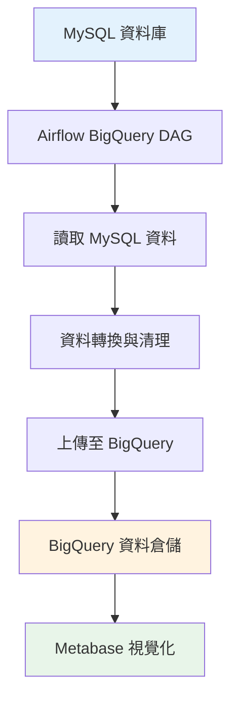

<div align="center">

# 🏀 NBAcharts
### *NBA數據分析與視覺化平台*

[](https://python.org)
[](https://airflow.apache.org)
[](https://mysql.com)
[](https://cloud.google.com/bigquery)
[](https://docker.com)

*像Curry一樣精準，如LeBron般全能的NBA數據分析系統* 🐍⚡

</div>

---

## 🏆 專案概述

> **"數據不會說謊，就像投籃命中率一樣真實"** - 這個平台讓你成為NBA數據分析的MVP！

這是一個基於 Python 的**NBA數據工程解決方案**，實現從數據擷取到視覺化的完整流程。所有服務都在 Docker 容器中運行，透過 Docker Compose 實現一鍵部署與管理，就像完美的團隊配合一樣流暢！

### 🎯 專案pipeline

- **🏀 NBA全方位數據** - 涵蓋球隊與球員的狀態、進階統計、薪資分析與最新新聞
- **🗓️ 智慧工作流管理** - Airflow 實現數據擷取任務的自動排程與全面監控
- **🗄️ 企業級數據存儲** - 採用 MySQL 資料庫確保數據完整性與查詢效能
- **🔄 自動化數據同步** - MySQL 到 BigQuery 的自動同步機制
- **☁️ 雲端數據倉儲** - 整合 Google BigQuery 實現大數據分析與長期存儲
- **� 商業智慧視覺化** - 透過 Metabase 建立專業級互動式儀表板
- **🐳 一鍵容器化部署** - 每個服務獨立容器化，透過共用網路實現完美互聯

---

## 🎯 主要資料結構

### 🏀 球員數據分析
- **💰 薪資追蹤** - 2014-2025年完整薪資數據，支援薪資趨勢分析
- **📊 表現統計** - 投籃命中率、籃板、助攻等30+項詳細數據
- **🎯 效率指標** - 真實命中率、有效投籃命中率等進階統計

### 🏟️ 球隊深度分析
- **💸 薪資結構** - 球隊總薪資與薪資分配分析
- **🏆 戰績統計** - 勝率、淨勝分、畢氏勝場數等
- **⚡ 進階指標** - 進攻/防守評分、節奏因子、賽程強度

### 📰 新聞情報整合
- **🏀 官方新聞** - NBA.com即時新聞頭條
- **📺 媒體報導** - UDN體育新聞整合
- **🔄 自動更新** - 每日定時擷取最新資訊

---

## 📁 專案結構

```
🏀 NBAcharts/
├── 📊 data_ingestion/              # 核心數據擷取引擎
│   ├── 🏀 nba_players_salary.py    # 球員薪資爬蟲 (HoopsHype)
│   ├── 📈 nba_players_state.py     # 球員表現統計
│   ├── 🏟️ nba_teams_salary.py      # 球隊薪資分析
│   ├── 📊 nba_teams_state.py       # 球隊基礎數據
│   ├── 🎯 nba_teams_advance.py     # 球隊進階統計
│   ├── 📰 nba_news_headline.py     # NBA官方新聞
│   ├── 📰 nba_news_udn.py          # UDN體育新聞
│   ├── 🔧 config.py                # 環境配置管理
│   ├── 🗄️ mysql.py                 # MySQL資料庫連接與表結構
│   ├── ☁️ bigquery.py              # BigQuery資料庫操作
│   ├── 🔄 nba_sync_mysql_to_bigquery.py # MySQL到BigQuery同步
│   ├── ⚡ worker.py                # Celery工作者配置
│   └── 🔄 dataprocess.py           # 數據處理與合併
│
├── 🚀 airflow/                     # Apache Airflow 工作流
│   ├── 📋 dags/
│   │   ├── 🏀 NBA_data_dag.py      # NBA數據處理DAG
│   │   ├── 📰 NBA_news_dag.py      # 新聞擷取DAG
│   │   └── ☁️ NBA_bigquery_dag.py  # BigQuery同步DAG
│   ├── ⚙️ airflow.cfg              # Airflow配置
│   └── 🐳 docker-compose-airflow.yml
│
├── 📊 metabase/                    # 商業智慧視覺化
│   └── 🐳 docker-compose-metabase.yml
│
├── 🐳 Docker配置檔案
│   ├── docker-compose-mysql.yml    # MySQL資料庫
│
└── 📋 pyproject.toml               # Python專案配置
```

---

## 🚀 快速啟動指南

### 🏀 第一節：前置準備

```bash
# 🏆 確保已安裝 Docker 與 Docker Desktop
docker --version

# 🌐 建立 Docker 網路（讓所有服務能夠完美配合）
docker network create NBA_network
```

### 🏀 第二節：環境設定與安裝

#### 安裝 Python 依賴套件
本專案使用 `uv` 作為套件管理工具。
```bash
# 同步 pyproject.toml 中的依賴項目
uv sync
```

#### 環境變數設定

專案的環境變數儲存在 `.env` 檔案中，您可以從 `env.example` 複製一份來開始。

```bash
# 從範例文件複製一份 .env 設定檔
cp env.example .env
```
接著，請根據您的本機環境或需求，修改 `.env` 檔案中的設定值，例如資料庫密碼或 GCP 專案 ID。

```bash
# .env 檔案內容範例
# MySQL 配置
MYSQL_HOST=127.0.0.1
MYSQL_PORT=3306
MYSQL_USERNAME=root
MYSQL_PASSWORD=your_secure_password # <== 修改為你的密碼
MYSQL_ROOT_PASSWORD=your_secure_password # <== 修改為你的密碼

# GCP 配置
GCP_PROJECT_ID=your-gcp-project-id # <== 修改為你的GCP專案ID
```

### 🏀 第三節：啟動所有服務
按順序啟動各個核心服務：

```bash
# 🗄️ 1. 啟動資料庫 (MySQL)
docker compose --env-file .env -f docker-compose-mysql.yml up -d

# 🚀 2. 啟動 Airflow (Scheduler/Webserver)
docker compose --env-file .env -f airflow/docker-compose-airflow.yml up -d

# 📊 3. 啟動儀表板 (Metabase)
docker compose --env-file .env -f metabase/docker-compose-metabase.yml up -d
```

### 🏀 第四節：服務入口與管理介面

| 🎯 服務 | 🌐 網址 | 👤 帳號密碼 | 📝 說明 |
|---------|---------|-------------|---------|
| **🚀 Airflow** | http://35.206.118.222:8080 | `airflow` / `airflow` | 工作流管理與監控中心 |
| **📊 Metabase** | http://35.206.118.222:3000 | 初次設定 | 商業智慧分析平台 |
| **🗄️ MySQL** | http://35.206.118.222:3306 | 配置檔設定 | 資料庫連接 |
| **☁️ BigQuery** | GCP Console | GCP 帳號 | 雲端數據倉儲 |

---

## 🛑 關閉服務

若要停止並移除所有容器，請依相反順序執行：

```bash
docker compose -f metabase/docker-compose-metabase.yml down
docker compose -f airflow/docker-compose-airflow.yml down
docker compose -f docker-compose-mysql.yml down
```

---

## 🔍 疑難排解

### 常見問題與解決方案

- **❓ 看不到任務在執行？**
  - 確認 Airflow Web UI 中的 DAG 已啟用

- **❓ 資料未寫入 MySQL？**
  - 檢查 [`mysql.py`](data_ingestion/mysql.py) 的連線設定
  - 確認資料表是否正確初始化

- **❓ BigQuery 同步失敗？**
  - 檢查 GCP 認證金鑰是否正確設定
  - 確認 [`bigquery.py`](data_ingestion/bigquery.py) 的專案ID設定
  - 檢查 BigQuery API 是否已啟用

- **❓ Metabase 看不到資料？**
  - 確認 Metabase 能連線到 MySQL 容器（同一 network）
  - 檢查資料庫連接設定
  - 可嘗試連接 BigQuery 作為額外數據源

- **❓ 容器間連線失敗？**
  - 確認所有容器都加入了 `NBA_network`
  - 檢查 `.env` 與各 compose 檔中的服務主機名稱、帳密、埠號一致

---

## 📊 資料庫架構

### 🏀 核心資料表

| 📋 資料表 | 📝 說明 | 🔑 主鍵 | 📈 資料範圍 |
|-----------|---------|---------|-------------|
| `nba_player_salary` | 球員薪資數據 | year, player, team | 2014-2025 |
| `nba_player_state` | 球員表現統計 | year, player, team | 詳細比賽數據 |
| `nba_team_salary` | 球隊薪資總額 | year, team | 年度薪資統計 |
| `nba_team_state` | 球隊基礎數據 | year, team | 基礎比賽統計 |
| `nba_team_advance` | 球隊進階統計 | year, team | 進階分析指標 |
| `nba_news_headline` | NBA官方新聞 | news_at, title | 即時新聞頭條 |
| `nba_news_udn` | UDN體育新聞 | id | 中文體育新聞 |

---

## ☁️ BigQuery 整合

### 🎯 BigQuery 功能特色
- **📊 大數據分析** - 支援PB級數據的快速查詢與分析
- **🔄 自動同步** - 透過 [`NBA_bigquery_dag.py`](airflow/dags/NBA_bigquery_dag.py) 定期同步MySQL數據
- **📈 進階分析** - 利用BigQuery的SQL分析功能進行複雜統計
- **💰 成本效益** - 按查詢量計費，適合大規模數據分析

### 🔧 BigQuery 設定步驟
1. **建立GCP專案** - 在Google Cloud Console建立新專案
2. **啟用BigQuery API** - 確保BigQuery API已啟用
3. **建立Service Account** - 下載JSON金鑰檔案
4. **設定環境變數** - 在 `.env` 檔案中配置專案ID和金鑰路徑

### 📊 數據同步流程


---

### 🔧 核心技術
- **🐍 Python 3.10+** - 核心開發語言
- **🕷️ BeautifulSoup4** - HTML解析與網頁爬蟲
- **📊 Pandas** - 資料處理與分析
- **🗄️ SQLAlchemy** - ORM與資料庫操作

### ⚡ 自動化系統
- **🚀 Apache Airflow** - 工作流程編排與調度

### 🗄️ 資料存儲與視覺化
- **🐬 MySQL** - 關聯式資料庫
- **☁️ Google BigQuery** - 雲端數據倉儲
- **📊 Metabase** - 商業智慧與視覺化

### 🐳 部署與維運
- **🐳 Docker** - 容器化部署
- **🔧 Docker Compose** - 多服務編排

---

## 🙏 致謝

- **🏀 Basketball-reference** - NBA數據來源
- **💰 HoopsHype** - NBA球員薪資數據來源
- **📰 UDN體育** - 中文體育新聞整合
- **🐍 Python社群** - 優秀的開源工具與函式庫
- **🚀 Apache基金會** - Airflow工作流程管理工具
- **☁️ Google Cloud** - BigQuery雲端數據倉儲服務

---

<div align="center">

### 🏆 讓數據說話，讓分析發光！

**如果這個專案對你有幫助，請給我們一個 ⭐ Star！**

*Built with ❤️ for NBA data enthusiasts*

</div>